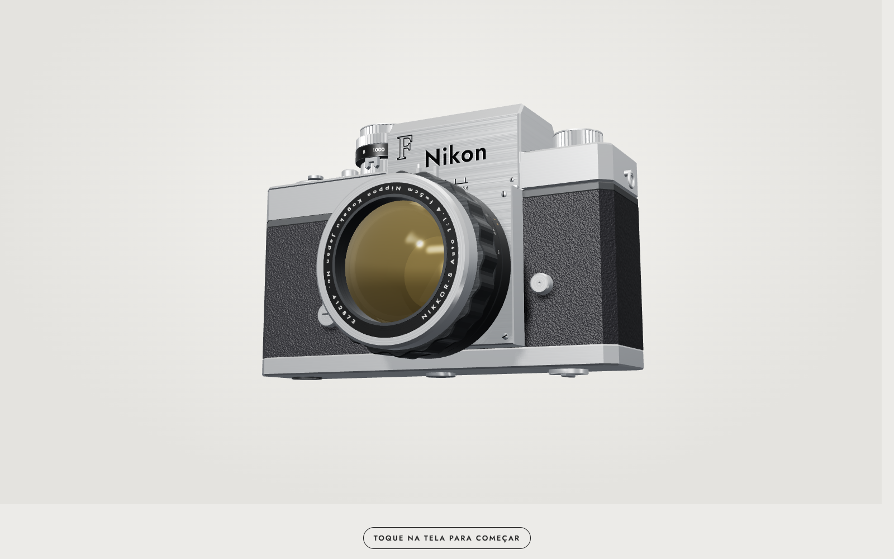

# Cena explodida 3D

Um motor para cenas de rolagem em que um objeto se desmonta em peças 3D, as peças se movem e
o objeto se monta de novo, tudo controlado pelo scroll da página. Feito com Three.js e GSAP
ScrollTrigger, e testado para rodar no iPhone.



## As três partes

| Pasta | O que é |
|---|---|
| `cena-explodida-scroll/` | O motor (`motor/`), os objetos (`props/`) e o script que junta tudo num HTML (`scripts/compor.cjs`). |
| `cena-blueprint-3d/` | Plugin que transforma o objeto em desenho técnico de linhas durante a rolagem, com cotas e rótulos. |
| `cena-explodida-interativa/` | Plugin que deixa o usuário abrir, arrastar e girar as peças com o mouse ou o dedo. |

Objetos prontos: uma câmera Nikon F, um toca-discos Dual 1019 e um relógio.

## Regras do motor

- Toda peça é um sólido com espessura, não uma folha.
- Cada objeto tem estilo e materiais próprios.
- Peças embutidas nascem do contorno da peça-mãe, para encaixarem sem frestas.

## Montar uma cena

```bash
cd cena-explodida-scroll
node scripts/compor.cjs props/nikon-f saida.html --plugin ../cena-blueprint-3d/plugin --plugin ../cena-explodida-interativa/plugin
```

Os testes automáticos ficam no repositório `arsenal-scroll3d`.

Cada pasta também é uma skill do Claude Code: o `SKILL.md` ensina o Claude a usar o motor.
Desenvolvido com Claude Code e Codex.
